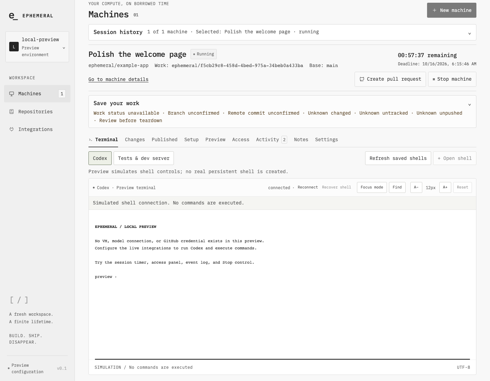
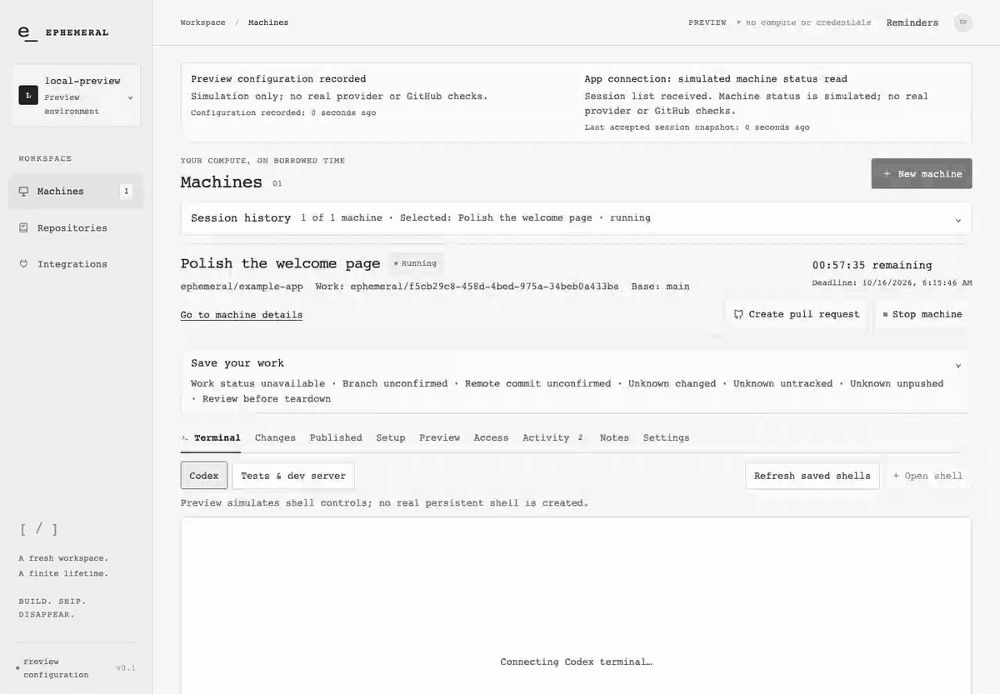
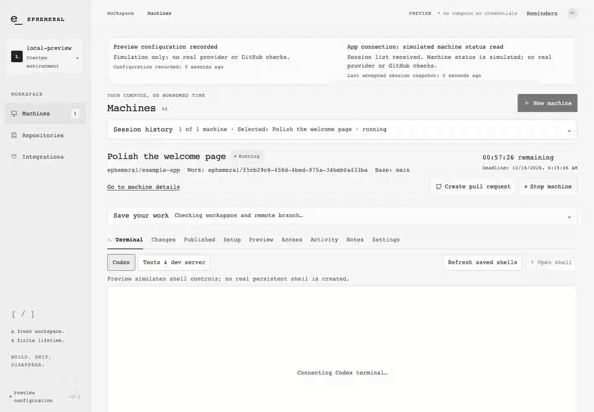
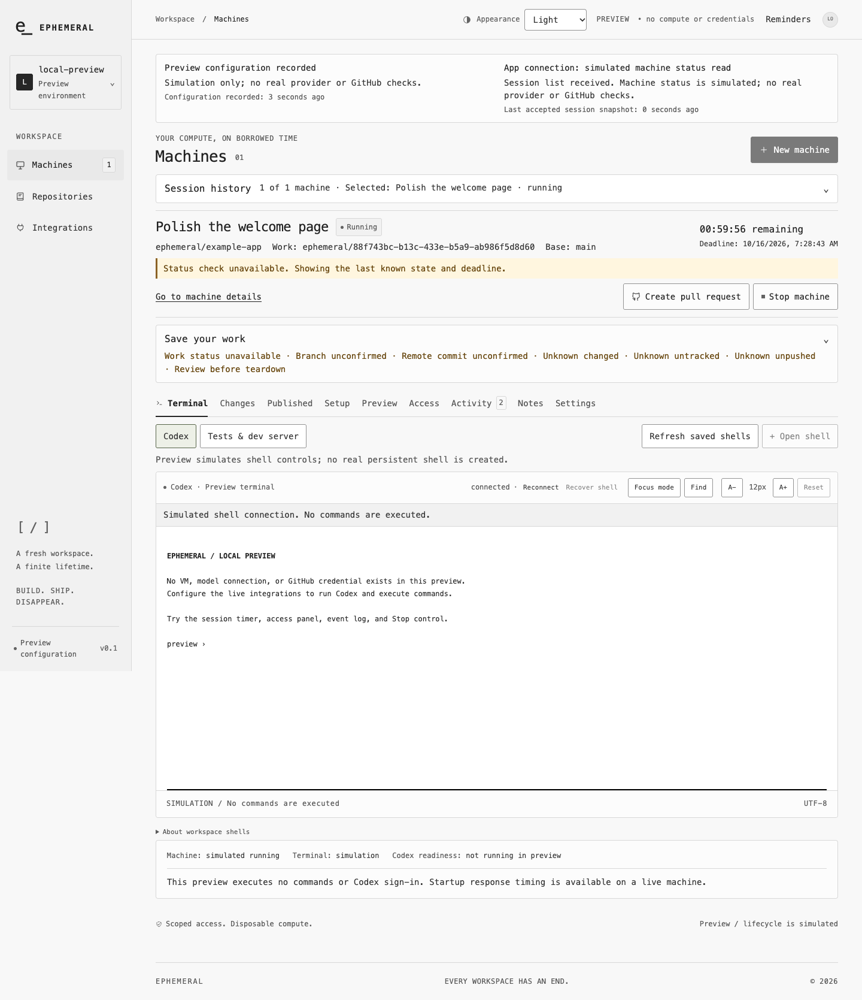
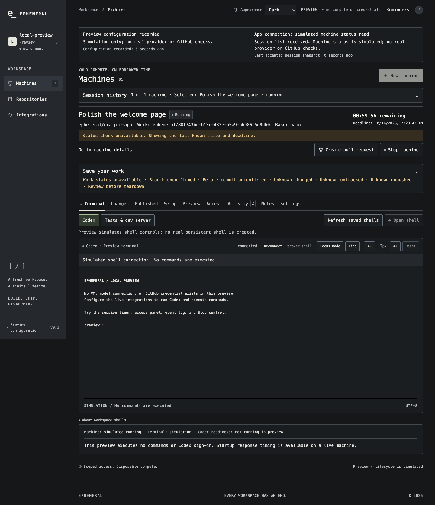
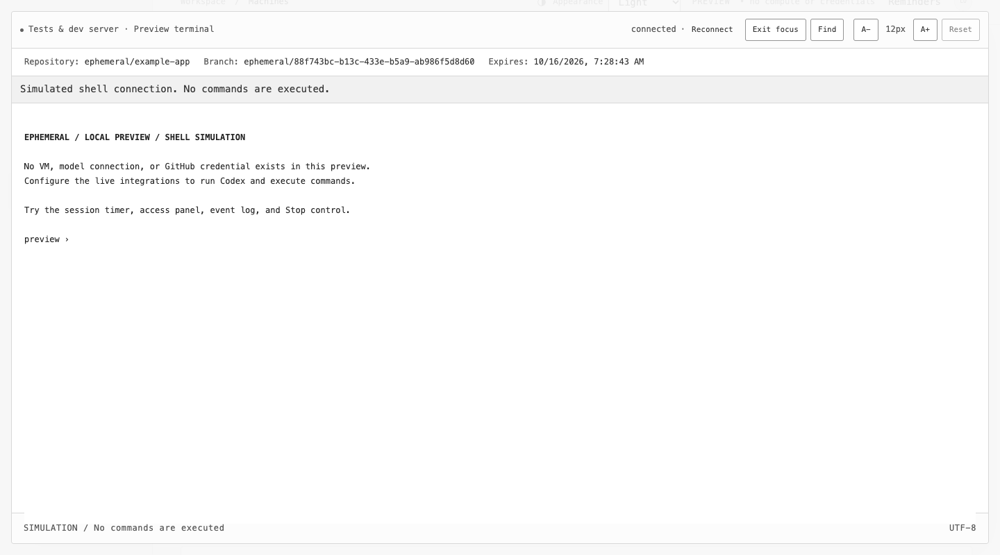
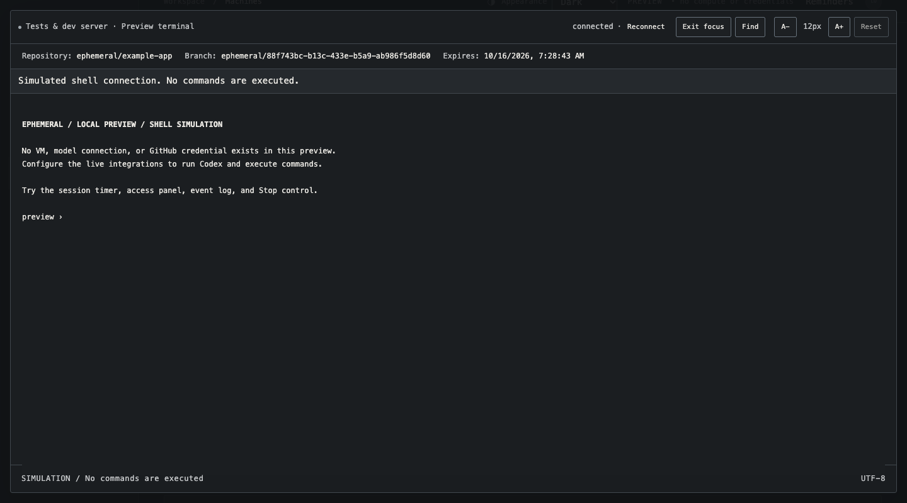
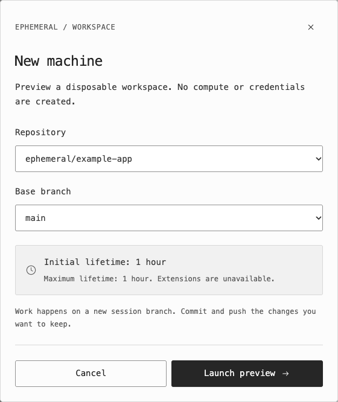
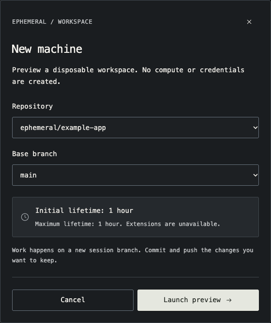

# Ephemeral

**Disposable cloud coding workspaces for OpenAI Codex.** Each session gets a fresh [E2B](https://e2b.dev) microVM, a fresh ChatGPT/Codex sign-in, and GitHub access scoped to a single session branch. Stop the session or let it expire to destroy its compute and clean up its credentials.

[](LICENSE)
[](https://github.com/scasella/ephemeral/releases)
[](.nvmrc)
[](#project-status)



*Local simulation with synthetic repositories; no VM, model response or credentials. [Screenshot-led usage guide](docs/USAGE.md).*

## Why Ephemeral

Running a coding agent on your own machine gives it your files and your long-lived credentials. Ephemeral runs each task in a short-lived cloud VM instead, and is self-hosted so the control plane stays yours.

- **A fresh machine every time.** Each session is a new E2B microVM with its own branch, a browser terminal backed by tmux, and a one-hour lifetime (extendable to four hours on E2B Pro).
- **Branch-scoped GitHub access.** A server-side Git gateway permits pushes only to the assigned session branch and exposes no merge API. GitHub installation tokens never enter the VM.
- **Your own Codex account.** Sign in with Codex's device-code flow on OpenAI's page. Model access uses your eligible ChatGPT/Codex plan; no provider API key is required.
- **Cleanup you can inspect.** VM, GitHub, gateway and Codex cleanup are recorded separately. Failures stay visible and retry through reconciliation instead of being reported as done.
- **Review before you hand off.** Inspect uncommitted changes, review the pushed comparison against the base branch, then open a draft pull request.
- **Pick up where you left off.** Save private next-session notes, then continue from a verified pushed commit in a fresh machine.
- **Private app previews.** Open a dev server running in the VM through an isolated, short-lived browser origin, with support for Vite hot module replacement.

## Try it in a minute — no accounts needed

Requires Node.js 24 LTS and Git.

```sh
git clone https://github.com/scasella/ephemeral.git
cd ephemeral
npm ci
npm run local
```

Open http://localhost:4310. `npm run local` starts a **clearly labeled local simulation**: the real session lifecycle and embedded PostgreSQL, with a simulated VM and cleanup. It needs no account, domain, tunnel or Docker, executes no terminal commands and creates no pull requests. If port 4310 is busy, run `npm run local -- --port 4311`.

## See the workflow

Launch from a repository, keep Codex and a second shell within reach, save next-session notes, and inspect cleanup when the machine ends.

| Task | Walkthrough |
| --- | --- |
| Choose light, dark or system appearance | [Appearance settings](docs/USAGE.md#choose-your-appearance) |
| Choose a repository and start a machine | [Launch](docs/USAGE.md#launch-a-machine) |
| Switch shells, enlarge the terminal and search output | [Terminal controls](docs/USAGE.md#keep-codex-and-a-second-shell-within-reach) |
| Save context for the next session | [Handoff notes](docs/USAGE.md#save-a-next-session-handoff) |
| Find an earlier task without losing active work | [Session history](docs/USAGE.md#find-earlier-work) |
| Stop a machine and inspect each cleanup outcome | [Cleanup](docs/USAGE.md#stop-and-check-cleanup) |

<details>
<summary>Watch: terminal Find, focus mode and shell switching</summary>



[Static terminal screenshot and written steps](docs/USAGE.md#keep-codex-and-a-second-shell-within-reach). Commands are not executed in simulation.

</details>

<details>
<summary>Watch: edit, save and reload handoff notes</summary>



[Static notes screenshot and written steps](docs/USAGE.md#save-a-next-session-handoff). Notes persist in the control-plane database; they do not save repository files.

</details>

## Light and dark mode

Choose **Appearance → System / Light / Dark** in the header. System follows your device. Your choice is saved in this browser and synchronized across tabs; both terminals update without reconnecting or clearing their output. Click any screenshot for the full-size view.

| Light workspace | Dark workspace |
| --- | --- |
| [](docs/media/appearance-workspace-light.png) | [](docs/media/appearance-workspace-dark.png) |

| Light terminal focus mode | Dark terminal focus mode |
| --- | --- |
| [](docs/media/appearance-terminal-light.png) | [](docs/media/appearance-terminal-dark.png) |

| Light launch dialog | Dark launch dialog |
| --- | --- |
| [](docs/media/appearance-launch-light.png) | [](docs/media/appearance-launch-dark.png) |

*Matching captures from local simulation with synthetic data. No real compute, account credentials or model responses. Applications opened through Preview control their own appearance. [Media provenance](docs/media/README.md).*

## Run real sessions

Real sessions need an [E2B](https://e2b.dev) account and custom template, your own GitHub App, an HTTPS tunnel reachable from E2B, and a ChatGPT account eligible for Codex. The guided setup walks through each step and builds a paid E2B template only with your explicit approval:

```sh
npm ci
npm run setup
npm run live
```

See [first-run setup](docs/FIRST-RUN.md) for prerequisites, costs and verification, and the [reference](docs/REFERENCE.md#enable-real-sessions) for manual configuration, PostgreSQL, Docker Compose and Render deployment.

## Project status

Ephemeral is **experimental**. The latest release is the [v0.1.1 prerelease](https://github.com/scasella/ephemeral/releases/tag/v0.1.1) ([changelog](CHANGELOG.md)). It is a self-hosted project with a GitHub account allowlist, one control-plane instance and one active machine per user. It is not a hosted service and has not had a security audit.

Compute teardown, local credential removal and upstream revocation are independent outcomes. Remote ChatGPT/Codex token revocation is **unverified**, so this version must not be described as automatically revoking every upstream account credential. See [cleanup semantics](docs/REFERENCE.md#cleanup-semantics), [operational limits](docs/REFERENCE.md#operational-limits), [validation scope](docs/VALIDATION.md) and [release readiness](docs/RELEASE-READINESS.md).

## Documentation

| Guide | What it covers |
| --- | --- |
| [Using Ephemeral](docs/USAGE.md) | Screenshot tour of launch, terminals, notes, history and cleanup |
| [Reference](docs/REFERENCE.md) | Release status, setup details, every workspace feature, cleanup semantics and limits |
| [First-run setup](docs/FIRST-RUN.md) | Guided live configuration with a tunnel, GitHub App and E2B template |
| [Local live testing](docs/LOCAL-LIVE.md) | A real E2B smoke test with the control plane on your Mac |
| [Architecture](docs/ARCHITECTURE.md) | Components, trust boundaries and failure model |
| [E2B](docs/E2B.md) · [GitHub](docs/GITHUB.md) | Template build and GitHub App setup |
| [Deployment](docs/DEPLOYMENT.md) · [Hosting](docs/HOSTING.md) | Singleton Docker deployment and hosting compatibility |
| [Operator recovery](docs/OPERATOR-RECOVERY.md) | Offline inspection and cleanup retry |
| [Roadmap](docs/ROADMAP.md) | Completed and current priorities |

## Contributing and security

Bug reports and proposals are welcome through the issue templates; see [CONTRIBUTING](CONTRIBUTING.md) for local checks. Report vulnerabilities privately through [GitHub private reporting](https://github.com/scasella/ephemeral/security/advisories/new), never in a public issue. See [SECURITY](SECURITY.md).

## License and credit

Copyright (c) 2026 scasella. The [MIT License](LICENSE) requires retaining the copyright and permission notice in copies or substantial portions of this software. Dependencies retain their own licenses.

If Ephemeral helps your project, a visible “Built with Ephemeral by scasella” credit is appreciated. This is an optional request, not an additional license condition; no UI badge or promotional credit is required.
