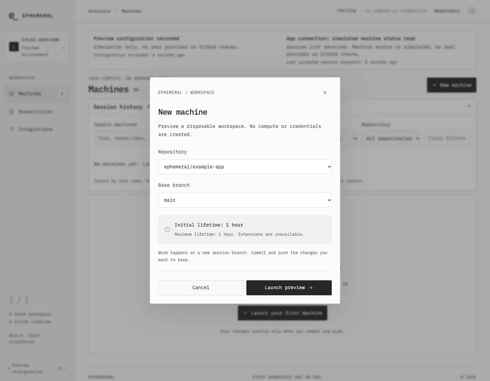
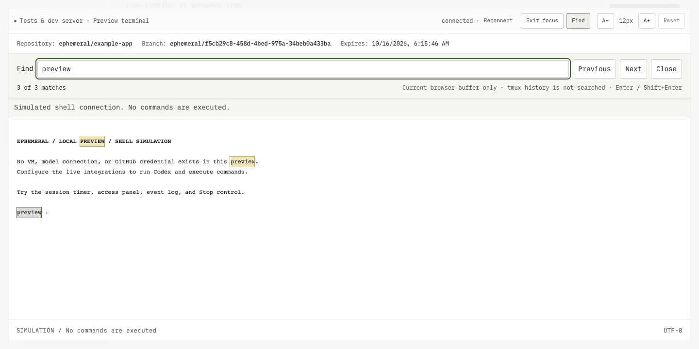
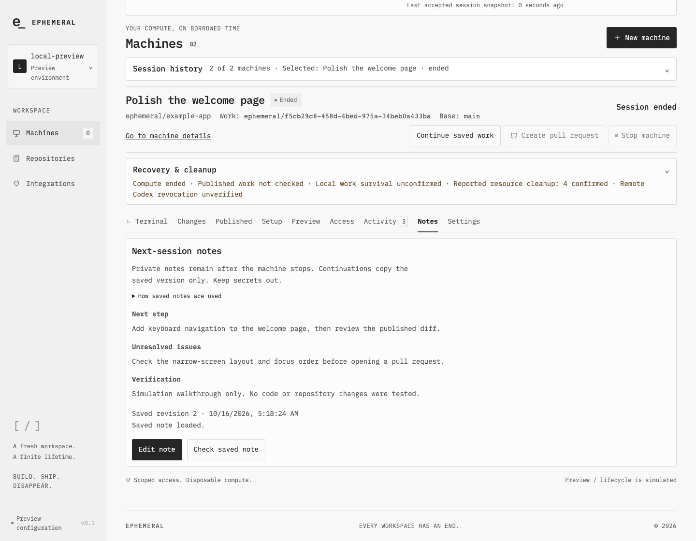
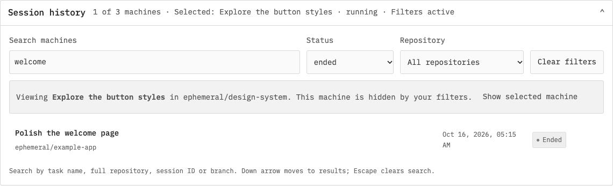
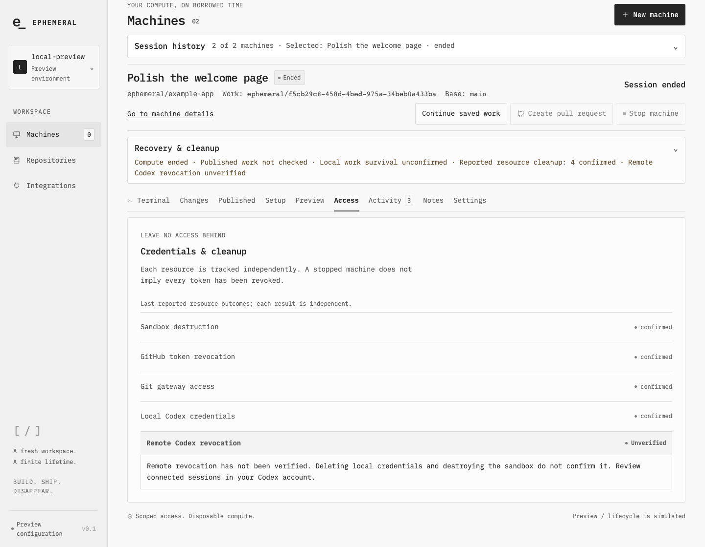

# Using Ephemeral

Choose a repository, work in a disposable machine, push the changes you want to keep, and save a note for your next session.

Every screenshot and GIF below comes from the actual app in **local simulation**, using synthetic repositories and notes. Simulation exercises the interface but does not create a VM, execute commands, connect to Codex, inspect real repository changes, or create a pull request. These images are a usage tour, not evidence of live integrations or upstream token revocation. [Media provenance](media/README.md).

To follow along without accounts or credentials:

```sh
npm ci
npm run local
```

Open http://localhost:4310. For real sessions, follow [guided first-run setup](FIRST-RUN.md) first; it includes private configuration, your tunnel, GitHub App and E2B template. A fresh real VM requires a fresh Codex device sign-in.

## Launch a machine

1. Choose **New machine**.
2. Select a repository available to your GitHub identity and App installation, then a base branch.
3. Review the one-hour lifetime and launch. In simulation, the action is labeled **Launch preview**; live mode uses **Launch machine**.



The selected machine shows its repository, work branch, state and original expiry deadline. In a real session, complete the Codex device login and visible trust prompts in Terminal before asking for a task. Only confirm a useful response after you have observed one.


**Settings → Task name** gives the work a recognizable name for history. Reconnecting or changing views does not extend compute. Files on the machine remain disposable: commit and push changes you want to retain.

## Keep Codex and a second shell within reach

**Terminal → + Open shell** opens one named supplemental shell. In a live machine, use it for tests or a development server while the protected Codex terminal remains available. Both shells share the repository, access and expiry deadline. Simulation only demonstrates the controls.

Switch shell tabs to return to either buffer. The selected machine's terminal remains attached while you visit its other detail tabs, Repositories or Integrations. Browser buffers are transient: reload, a different machine or teardown disposes them; live tmux persistence is limited to the machine's lifetime.

Use **Focus mode** for more space and **A− / A+ / Reset** for font size. **Find** searches the current browser buffer, with highlighted matches and previous/next controls. It does not search tmux history. Ctrl/Cmd+F inside the terminal opens Find. Escape on toolbar/search controls closes Find, then focus mode; Escape in the shell still reaches Codex.



<details>
<summary>Watch the terminal walkthrough (animated GIF)</summary>


</details>

The GIF shows the same controls as the still image: focus the supplemental shell, search its output, leave focus mode, then switch to Codex and back. **Close shell** requires confirmation and stops ordinary commands belonging to the supplemental shell; it preserves Codex. No commands execute in this demo.

## Save a next-session handoff

In **Notes**, select **Edit note** and fill in **Next step**, **Unresolved issues** and **Verification**. Choose **Save note**, check the saved revision, then **Done editing**. Saved notes remain in the control-plane database after reload, machine stop and control-plane restart, provided that database is retained.



<details>
<summary>Watch editing, saving and reloading a note (animated GIF)</summary>


</details>

Unsaved drafts stay only in memory across detail tabs and views for the selected machine; reload or machine selection can discard them. Notes do not save code, prove verification, or send instructions to Codex. Keep credentials out of all three fields.

In live mode, **Continue saved work** reviews a verified published commit and the saved note before creating a fresh machine. It captures that note revision as an inherited copy; later edits to the source cannot change it. This continuation flow is unavailable in simulation. See the [full workflow and recovery limits](../README.md#workflow).

## Find earlier work

Expand **Session history**. Search by task name, full repository, session ID or branch; optionally filter by status and repository. Use **Settings → Task name** to make tasks easier to recognize.



Filtering does not switch machines. When the selected machine falls outside the results, the notice explains that and offers **Show selected machine**. Click a history row to change selection. Down arrow from Search moves to results; Escape clears the search. **Return to active work**, when shown in another view or machine, checks and returns to the observed active machine.

## Stop and check cleanup

In a real session, review **Changes**, commit and push intentional work, then review the pushed head/base comparison in **Published** before creating a PR. These inspections are unavailable in simulation; its warning is expected. Save a handoff note separately if you want context for the next session.

Choose **Stop machine**, review the workspace observation and any uncertainty, and acknowledge possible loss when required. Then choose **Stop & clean up**. Automatic expiry does not wait for inspection or save work for you.



**Access** reports each cleanup outcome independently. An ended machine or completed local credential removal does not establish remote ChatGPT/Codex token revocation; that remains **unverified**. The screenshot's simulated outcomes are not provider evidence. If real cleanup remains pending, keep the control-plane database and encryption key, leave the app available for retries, and consult [operator recovery](OPERATOR-RECOVERY.md).

## What the tour does not show

Real GitHub OAuth and Codex device sign-in require your own account actions. The screenshots intentionally exclude those pages, private configuration, device codes and real repository content. Private application Preview needs a separate viewer-origin configuration and a real running machine; `npm run local` cannot demonstrate its readiness or HMR. See [validation scope](VALIDATION.md) for the distinction between local regression checks and historical live tests.
